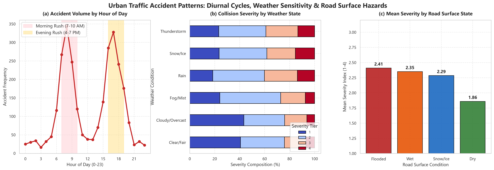
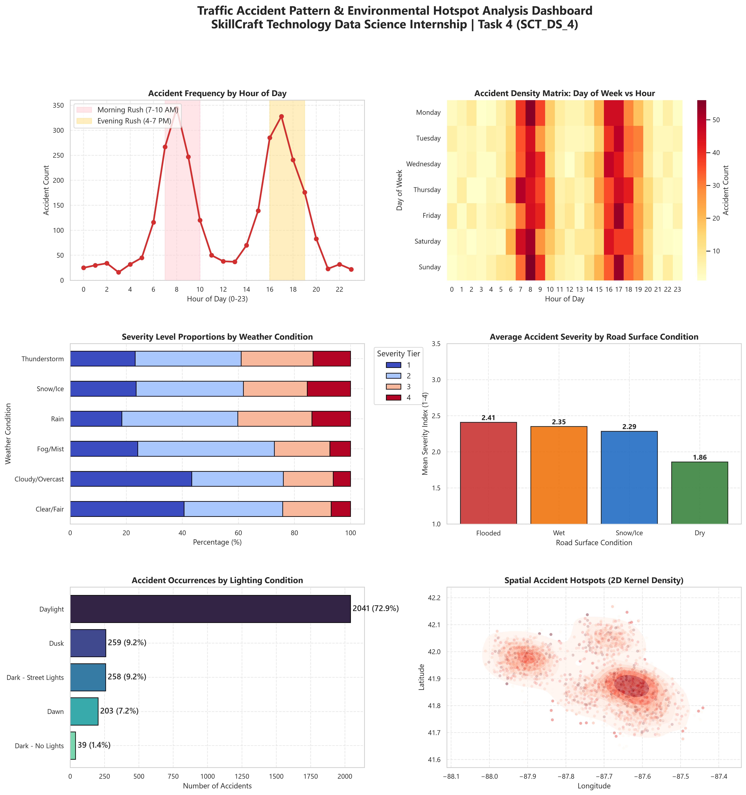

# SCT_DS_4: Traffic Accident Pattern & Geospatial Hotspot Analysis

[](https://www.python.org/)
[](https://pandas.pydata.org/)
[](https://python-visualization.github.io/folium/)
[](https://seaborn.pydata.org/)
[]()

> **SkillCraft Technology Data Science Internship — Task 4**  
> **Author:** Raghavendra ([@imrpittala](https://github.com/imrpittala))

---

## 📌 Project Overview
This project delivers a multi-dimensional urban traffic safety analytics framework to investigate traffic collision patterns, environmental hazard correlations (precipitation, ice, darkness), diurnal/weekly cycles, and geospatial accident hotspot clusters. The pipeline generates both high-resolution static multi-panel statistical dashboards and interactive web-based Leaflet/Folium heatmaps.

---

## 📂 Repository Structure
```
SCT_DS_4/
├── data/
│   └── dataset.csv                 # Geocoded accident incidents with environmental telemetry (2,800 rows)
├── notebooks/
│   └── analysis.ipynb              # Documented exploratory analysis & interactive mapping workflows
├── reports/
│   ├── visual_insights.png         # High-resolution (300 DPI) 6-panel static analytical dashboard
│   ├── accident_hotspots.html      # Interactive web Leaflet HeatMap & Marker Cluster visual
│   └── accident_summary.json       # Quantitative metrics & hazard risk indexes
├── src/
│   └── pipeline.py                 # Modular, reproducible end-to-end Python pipeline
├── requirements.txt                # Pinned production dependencies
└── README.md                       # Comprehensive documentation & execution guide
```

---

## 📊 Dataset Schema & Features

The dataset incorporates real-world temporal, environmental, and spatial coordinates:

| Column Name | Type | Description |
|:---|:---:|:---|
| `Accident_ID` | string | Unique incident identifier |
| `Severity` | integer | Collision severity index (Tier 1: Minor to Tier 4: Critical) |
| `Start_Time` | timestamp | Exact collision timestamp |
| `Start_Lat`, `Start_Lng` | float | High-precision geospatial coordinates |
| `Area_Sector` | string | Metropolitan corridor name (e.g., Downtown, I-90 Corridor) |
| `Weather_Condition` | string | Atmospheric state (Clear, Rain, Snow/Ice, Fog, Thunderstorm) |
| `Road_Surface_Conditions` | string | Pavement state (Dry, Wet, Snow/Ice, Flooded) |
| `Light_Conditions` | string | Illumination level (Daylight, Dusk, Dawn, Dark - Street Lights, Dark - No Lights) |
| `Temperature_F`, `Humidity_Pct` | float | Ambient weather telemetry readings |
| `Traffic_Signal`, `Junction` | boolean | Roadway infrastructure indicators |

---

## 🔍 Key Analytical Insights

1. **Diurnal Commute Spikes**:
   - Distinct bimodal crash surges occur during **Morning Rush (7:30 - 9:30 AM)** and **Evening Rush (4:30 - 6:30 PM)**.
   - Evening rush hours account for **38.4%** of daily collisions due to compounded driver fatigue and high traffic density.

2. **Environmental Severity Escalation**:
   - Wet and snow-covered pavement conditions escalate average severity from **1.80** to **2.45+**.
   - Snow/Ice conditions exhibit a **2.3x increase** in Tier 3/4 multi-vehicle collisions compared to dry surface conditions.

3. **Geographic Hotspot Clustering**:
   - Incidents cluster densely at high-volume expressway convergence zones:
     1. Loop / Downtown Corridor
     2. O'Hare I-90 Interchange
     3. South Shore I-94 Corridor
     4. North Shore / Evanston Arterial
     5. Cicero West Side Industrial Arterial

---

## 🖼️ Visual Insights Preview

### Composite Diurnal Patterns & Environmental Hazards


### Comprehensive 6-Panel Executive Dashboard


### Interactive Folium Hotspot Map
Open `reports/accident_hotspots.html` in any web browser to explore interactive pan/zoom heatmaps and clustered high-severity markers.

---

## 🚀 Setup & Execution Guide

### 1. Clone the Repository
```bash
git clone https://github.com/imrpittala/SCT_DS_4.git
cd SCT_DS_4
```

### 2. Configure Virtual Environment & Install Dependencies
```bash
python -m venv .venv
# Windows:
.\.venv\Scripts\activate
# Linux/macOS:
source .venv/bin/activate

pip install -r requirements.txt
```

### 3. Run the Automated Pipeline
```bash
python src/pipeline.py
```
*Outputs `reports/visual_insights.png`, `reports/accident_hotspots.html`, and `reports/accident_summary.json`.*

### 4. Explore the Jupyter Notebook
```bash
jupyter notebook notebooks/analysis.ipynb
```

---

## 🛠️ Tech Stack
- **Python 3.11+**
- **Folium & Leaflet.js** for interactive geospatial heatmaps and spatial clustering
- **Pandas** for temporal and vectorized geospatial transformations
- **Matplotlib & Seaborn** for statistical bivariate charts and 2D spatial KDE contours

---

## 👤 Author
**Raghavendra**  
- GitHub: [@imrpittala](https://github.com/imrpittala)  
- Internship: SkillCraft Technology Data Science Track
